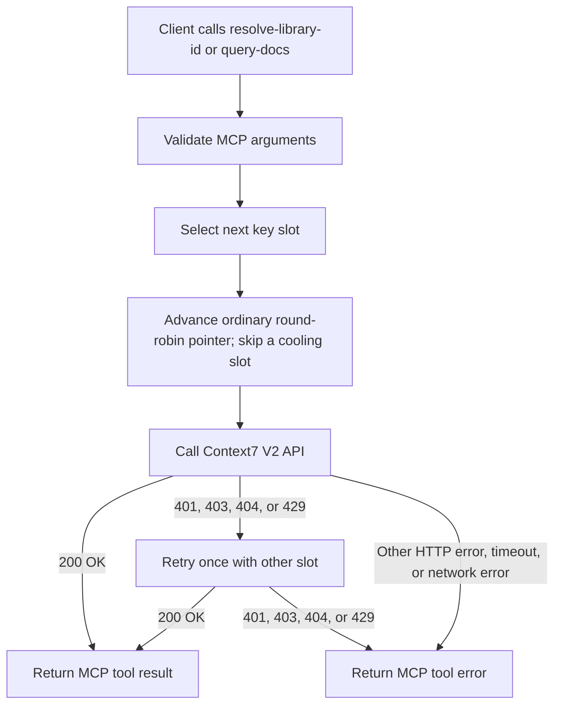

# Context7 Key Rotator MCP

A small remote [Model Context Protocol](https://modelcontextprotocol.io/) server for Context7 V2. It serves Upstash's Context7 MCP tools over one Streamable HTTP endpoint and spreads their upstream calls over two API keys:

- `resolve-library-id(libraryName, query)` and `query-docs(libraryId, query, language?, version?)`: documentation lookup.
- `get-upgrade-guide(libraryId, fromVersion, toVersion?, page?)`: what changes between two versions of a library.
- `grep-code`, `glob-code`, `read-code`, `find-symbol`: search a library's source at the version its docs describe.
- `context7-usage()`: each key's requests this month, its plan allowance, the reset date, and which experimental tools its teamspace has on. Keys are named by slot index only.

The tool schemas, descriptions and server instructions are copied from [upstash/context7](https://github.com/upstash/context7) `packages/mcp` (MIT; see [`src/upstream/`](src/upstream/)). Upstream's `submit-docs-feedback` is left out: it only sends ratings to Context7. The upgrade guide and code tools are experimental upstream and answer only for a key whose teamspace has them turned on in the [dashboard](https://context7.com/dashboard?tab=settings); keep both teamspaces the same, and check with `context7-usage`.

The deployed endpoint is:

```
https://context7.tyrannosaurus-magellanic.ts.net/mcp
```

It is published as the tailnet service `svc:context7` and is reachable only from inside the tailnet. Clients authenticate to the network boundary; they do not receive or store a Context7 key.

## How rotation works

`CONTEXT7_API_KEYS` must contain exactly two comma-separated keys. A process starts with slot 0, then selects slot 1, then slot 0 again for successive upstream operations. If the selected slot is cooling down after a `429` and the other slot is not, the other slot is used instead. The counter and cooldowns are process-local and are reset when the container restarts.

`tools/list` is local MCP metadata: it never calls Context7 and never advances the key selector. Each documentation, upgrade-guide and code tool call makes one logical Context7 operation on the next slot, so they all share one rotation. `context7-usage` asks both keys.



The fallback does **not** advance the ordinary round-robin pointer a second time. For example, if slot 0 returns `429` and slot 1 succeeds, the next logical operation still begins on slot 1. This means an exhausted slot adds retry latency to the requests selected for it, but it does not make those requests fail while the alternate slot works.

Only `401`, `403`, `404`, and `429` cause an alternate-key retry. A `500`, malformed upstream response, network failure, or timeout is returned as a tool error without a retry because it is not evidence that the selected key is the problem.

### Library filters and Context7 error codes

Each Context7 key belongs to a teamspace whose [library filters](https://context7.com/dashboard?tab=policies) decide which libraries it can see. Both teamspaces are set to the same filters, so either key gives the same answer. Keep them identical: if they differ, what a search returns depends on whose turn it is.

- In search results, a hidden library is simply left out. For `query-docs`, it announces itself with `403 access_denied` or `404 library_not_found`, and those are retried once on the other slot. `404 no_relevant_snippets` means the library exists but nothing matched the query; either key would answer it the same way, so it is returned without a retry.
- A `301 library_redirected` carries the new library ID in its JSON `redirectUrl` field and no `Location` header. `query-docs` follows it once and starts its answer with a note naming the new ID (for example `/facebook/react` now answers from `/react/react`). A `redirectUrl` that is not a library ID (`/owner/project[/version]`, or a `context7.com` URL with that path and no query) is not followed, and the `301` is returned as an error.

Cooldowns and retries are logged to stderr by slot index, never by key.

### Rate-limit cooldown

A `429` puts that slot into a cooldown for the `Retry-After` period Context7 sends (delta seconds or an HTTP date), or 60 seconds when the header is missing, capped at one hour. Ordinary selection skips a cooling slot while the other slot is available, so an exhausted key no longer adds retry latency to half of all calls. If both slots are cooling, ordinary rotation continues, and the fallback is still tried.

## Request records

Every tool call writes one JSON line to stdout through [pino](https://getpino.io), with `event: "tool_call"` and:

| Field | Meaning |
| --- | --- |
| `tool`, `libraryName`, `libraryId`, `query` | What was asked |
| `userAgent`, `requestId` | Which client asked; one ID per HTTP request |
| `outcome`, `errorStatus`, `errorCode`, `errorMessage` | `ok`, `empty` (Context7 answered with no documentation), or `error`, with Context7's error code such as `no_relevant_snippets` and its message |
| `resultCount`, `responseChars`, `redirectedTo` | What came back |
| `attempts[]` | Each upstream call: `slot`, `endpoint`, `status`, `code`, `durationMs` (including the body), `rateLimitRemaining`, `rateLimitLimit` |
| `upstreamCalls`, `durationMs`, `version` | Totals and the build that served it |

Slot rotation notes (`event: "rotation"`) and server errors (`event: "server_error"`) use the same stream. No record contains a key. Records do contain the callers' queries in full; that is the point of them, and it is why the tool descriptions tell agents to keep secrets out of queries.

When `TELEMETRY_LOKI_URL` is set, the same lines are also pushed with [pino-loki](https://github.com/Julien-R44/pino-loki) to a Loki-compatible endpoint in 5-second batches, labelled `job="context7-key-rotator"` and `event`. The defaults target VictoriaLogs behind vmauth:

| Variable | Default | Purpose |
| --- | --- | --- |
| `TELEMETRY_LOKI_URL` | unset (stdout only) | Base URL, e.g. `https://192.168.30.11:8427`. Any path in it is replaced by the endpoint below. A value that is not an `http(s)` URL turns pushing off with one warning |
| `TELEMETRY_LOKI_ENDPOINT` | `/insert/loki/api/v1/push?_msg_field=msg` | Push path; `_msg_field=msg` tells VictoriaLogs which field is the message |
| `TELEMETRY_LOKI_USERNAME`, `TELEMETRY_LOKI_PASSWORD` | unset | Basic auth for the push |
| `NODE_EXTRA_CA_CERTS` | unset | PEM file for a private CA in front of the endpoint |

A push failure is printed to stderr and never fails a tool call. On `SIGTERM` or `SIGINT` the server stops accepting requests, lets calls in progress finish (up to 20 seconds) so their records are written, then sends the last batch (up to 5 seconds) and exits, inside Kubernetes' default 30-second grace period.

A call whose arguments fail the tool's schema is rejected by the MCP SDK before the tool runs, so it has no record.

VictoriaLogs splits each pushed JSON line into fields, so every field above can be filtered and grouped. Example LogsQL queries:

```
job:"context7-key-rotator" event:"tool_call" _time:1d | stats by (tool, outcome) count()
job:"context7-key-rotator" event:"tool_call" outcome:"error" _time:1d | stats by (errorCode) count()
job:"context7-key-rotator" event:"tool_call" _time:1d | stats by (userAgent) count()
```

## Boundaries and limitations

- Each upstream attempt has a 60-second timeout. A blocked response that arrives before that timeout may be followed by one alternate attempt, and a redirect repeats that for the new library ID, so one `query-docs` call makes at most four upstream calls and can take up to roughly four upstream timeout windows; a `resolve-library-id` call makes at most two. There is no unbounded wait for an upstream request.
- The service intentionally has no key scoring, session affinity, persistent state, OAuth flow, CLI adapter, or proxy cache. Its only per-key state is the in-memory `429` cooldown. It is a two-key round-robin retry layer, not a quota manager.
- A container restart resets selection to slot 0. This is expected and does not alter the configured keys.
- There is no upstream-aware health endpoint. A running container proves only that the MCP server process is listening; prove Context7 availability with a real tool call.
- If both slots return a blocked status, the MCP call returns a normal tool error. It does not crash the server.

## Deployment topology

Production runs on the **homelab cluster** (Talos, reconciled by Flux) as one Deployment with two containers:

- `rotator` — the image published by `.github/workflows/publish.yml`, pinned by digest.
- `tailscale` — the stock `tailscale/tailscale` image running Tailscale Serve in userspace. It joins the tailnet as an ephemeral node, advertises `svc:context7`, and forwards `tcp:443` to `http://127.0.0.1:3000` over the pod's shared loopback.

A merge to `main` deploys itself:

1. `.github/workflows/publish.yml` pushes the image with the tags `main`, `main-<commit>`, and a sortable build tag `main-<UTC date>-<short sha>-<run>.<attempt>`. The build tag is also the MCP `serverInfo.version` the server reports.
2. Flux image automation in `MooseGooseConsulting/homelab-next` (`clusters/homelab/context7-image-automation.yaml`) scans GHCR every 5 minutes, picks the newest build tag, and rewrites the pinned tag and digest in `cluster/apps/context7-key-rotator.yaml` on the branch `flux-image-updates-context7`.
3. That repository's `context7-image-deploy` workflow opens a pull request for the branch and squash-merges it; the organization requires a pull request for every change to `main`. Flux then rolls the Deployment.

Expect a new build to be serving within about 15 minutes of the merge. To confirm, call `initialize` on the endpoint and compare `serverInfo.version` with the build tag in the publish run's summary.

Secrets reach the pod as ExternalSecrets sourced from Doppler. Nothing here or in the manifests holds a secret. Clients see the single stable name above; the workload moves by moving the pod.

The rotator previously ran on the physical Bloodarrow host from a checkout at `/opt/context7-key-rotator-mcp`, where Tailscale Serve on the host published `https://bloodarrow.tyrannosaurus-magellanic.ts.net/mcp` from the compose loopback port `127.0.0.1:23007`. That stack is retired once the cluster endpoint is cut over and verified. Rolling it back takes both halves of it, because compose republishes nothing on its own: `docker compose -f deploy/compose.yaml up -d --build` with the checkout still on the commit that was live when the stack was drained, and the host's Serve stanza put back.

## Client registration

The server serves its own installer at `GET /install.mjs`, built into the image with it, so the entry and skill it installs match the tools this build serves. On any machine on the tailnet with Node:

```sh
curl -fsSo install.mjs https://context7.tyrannosaurus-magellanic.ts.net/install.mjs
node install.mjs          # check: read-only report
node install.mjs apply    # register, remove conflicts, install the skill
```

See [installer/README.md](installer/README.md). The agents it knows, and what it treats as a conflict, are in [installer/core.ts](installer/core.ts). The skill it installs is Upstash's own, copied unchanged into [skills/](skills/).

Start a fresh client session after a change; it should list the tools above.

## Local development and validation

```powershell
npm ci
npm test
npm run build
```

`deploy/compose.yaml` is the local container path: it builds the repository `Dockerfile`, binds the container to physical-host loopback only, and reads `CONTEXT7_API_KEYS` from a root-owned `0600` file at `/etc/context7-key-rotator-mcp/context7.env`, which is not part of this repository.

```bash
docker compose -f deploy/compose.yaml up -d --build
```

The automated suite is deterministic: it mocks Context7 V2 responses and verifies MCP protocol handling, tool discovery, result formatting, normal alternation, alternate-key retry for `401`/`403`/`404`/`429`, Context7 error codes and redirects, request records, `Retry-After` cooldowns, both-key failure, and integration-test server lifecycle. Green automated tests do **not** prove the current upstream service or credentials work.

Live validation is separate. Use a real client or a protocol client to verify `tools/list`, then call `resolve-library-id` and `query-docs` with a real library. A valid result has an actual Context7 library ID, nonempty documentation, and source links or code/documentation content appropriate to the request.
